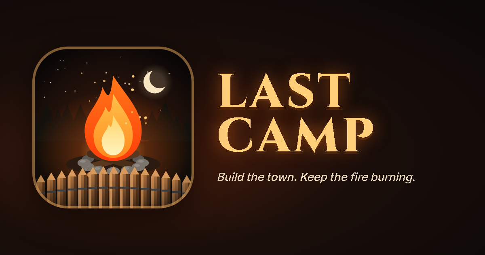

# Last Camp

An endless survival strategy game. Keep the fire burning and your survivors alive for as many nights as you can. Every night is harder than the last.

## How to run

- **Quick play (no accounts):** double-click `index.html`. Progress is saved in that browser only.
- **With online accounts on your computer:** `npm install`, then `npm run dev`, and open http://localhost:3000.
  This uses a temporary built-in database, so accounts reset when the server stops.
- **For real players:** deploy to Vercel (below). Players open your Vercel link, create an account,
  and their latest camp loads on any device they sign in from.

## Install as an app (phones and desktop)

Once deployed, open the site and tap **📲 Install App** in the main menu (Android and desktop Chrome/Edge).
On iPhone/iPad: Safari → **Share** → **Add to Home Screen**. The installed app opens full screen, locked to
landscape, and works offline (`manifest.webmanifest`, `sw.js`). Online saves still need a connection.

On phones the layout is unchanged; wide screens simply show more of the world. Touch controls: drag to pan,
pinch to zoom, tap to select. Holding the phone upright shows a "turn your phone sideways" notice and pauses the game.

## Online accounts and saves

The game has its own small backend in `/api`:

| Route | What it does |
|---|---|
| `POST /api/auth` | `signup`, `signin`, `signout` (passwords hashed with scrypt, 60-day session tokens, lockout after 8 wrong passwords in 15 min) |
| `GET /api/save` | returns the signed-in player's current run and permanent progress |
| `PUT /api/save` | stores them (called automatically at the start of every day and dusk, on game over and on ember purchases) |

Data lives in a **Neon Postgres** database. The tables (`lc_users`, `lc_sessions`, `lc_saves`, `lc_login_fails`) are created automatically on first use.
Neon's free plan sleeps when nobody is playing and **wakes up by itself** on the next request, so nothing ever has to be restarted by hand.
If a player loses internet, the game keeps saving on their device and uploads when they are back online.

### Deploying (one time)

1. Push this folder to a GitHub repository (`.gitignore` already excludes `node_modules` and `preview`).
2. On vercel.com: **Add New → Project → import the repo → Deploy.** No build settings needed.
3. In the Vercel project: **Storage → Create Database → Neon (Postgres) → Create**, then connect it to the project.
   This adds the `DATABASE_URL` environment variable.
4. **Deployments → Redeploy** (so the API picks up the database).
5. Open your Vercel link and create an account. That's it.

Optional: to let people play from a downloaded `index.html` with online saves, set `DEPLOYED_URL` in `js/cloud.js`
to your Vercel address.

Note: the backend doesn't send email, so there is no "forgot password" reset yet.

## How to play

- **Time runs on its own clock.** Day 06:00–18:00 · dusk 18:00–20:00 · **night 20:00–05:00** · dawn. Up to day 50 the days last longer (about 2 min 20 s including dusk) and nights pass quicker (about 1 min). Pause with ❚❚; game speed, sound and other options are in ⚙️ Settings.
- **👥 Tasks:** buildings only work while people are assigned to them. Farms grow food, the Lumber Mill sends woodcutters out to chop trees, the Stone Quarry mines rock, the Workshop makes arrows, the Armory boosts weapons, the Infirmary heals, and the Scout Post goes on expeditions. The **Construction crew** builds, upgrades and repairs.
- **🎭 Roles:** each role is 50% better at one job (Farmer, Lumberjack, Miner, Builder, Medic, Scavenger, Archer, Fighter).
- **🔨 Build:** pick a building, then click a highlighted spot. Click any building to see its stats, staff it and upgrade it (levels 1–5). Big upgrades need stone and a Storehouse.
- **🏠 Houses** decide how many people can live in camp. Strangers can only join when there is a free bed.
- **Night:** the dead arrive at random, from every direction. While the palisade stands they can only claw at it. Click a survivor, then the ground (or an archer tower) to give orders. If the fire goes out at night, the run ends. The fire keeper auto-feeds it from the woodpile (you can switch that off).
- **🧨 Demolish** any building except the palisade, gate and campfire (40% refund).
- Every 3 nights you pick a perk. Dying gives **embers** for permanent upgrades.

Controls: drag to pan · scroll to zoom · `WASD`/arrows pan · `C` re-centre · `Space` pause · `1` `2` `3` speed · `T` tasks · `R` roles · `B` build · `L` log · `F` add wood · `M` sound · `Esc` cancel

The game saves on this device at 06:00, 12:00, 18:00, after building or assignment changes, and when you leave the page. It also saves to your account when you're signed in.

## Code layout

| File | Purpose |
|---|---|
| `js/util.js` | helpers, safe storage, synthesized sound effects |
| `js/data.js` | all tuning numbers: roles, buildings and their per-level stats, enemies, perks, events |
| `js/game.js` | run state, stats, camp geometry, save/load |
| `js/town.js` | the clock, daily schedule, workers (chopping, mining, farming…), construction |
| `js/night.js` | night defence: random attackers, survivor combat AI |
| `js/draw.js` | procedural drawing of people, creatures and buildings |
| `js/render.js` | scene rendering, lighting, particles, weather |
| `js/ui.js` | menus, panels, modals |
| `js/main.js` | game loop, input, game flow |
| `js/cloud.js` | accounts and online save sync (talks to `/api`) |
| `js/app.js` | installable app: service worker, install button, landscape and fullscreen on phones |
| `sw.js`, `manifest.webmanifest`, `icons/` | offline cache, app manifest, logo and icons |
| `api/` | backend: `auth.js`, `save.js`, `_lib/db.js` (Neon / local PGlite), `_lib/http.js` |
| `dev-server.mjs` | local server for `npm run dev` |

To rebalance the game, start with `js/data.js` (`LC.BUILDINGS`, `LC.ENEMIES`, `LC.ROLES`) and `N.budget` in `js/night.js`.
